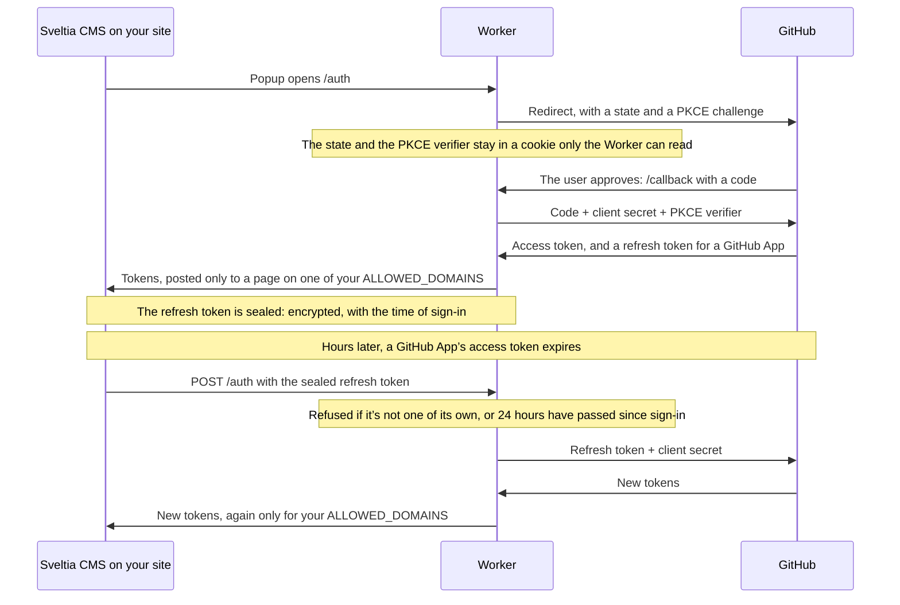

# Sveltia CMS Authenticator

A small [Cloudflare Workers](https://workers.cloudflare.com/) script that lets people sign into [Sveltia CMS](https://sveltiacms.app/en/) with **GitHub** (or GitLab) — no access tokens to create, just a “Sign In with GitHub” button.

GitHub won’t complete a sign-in from a web page alone: exchanging the sign-in code for an access token takes a client secret, which can’t be kept in a page. This Worker keeps the secret and makes that exchange, then hands the token to the CMS — and only to your site. It runs on Cloudflare’s free plan, stores nothing, and takes about 15 minutes to set up.

- [Do you need it?](#do-you-need-it)
- [How it works](#how-it-works)
- [Setup](#setup)
  1. [Deploy the Worker](#step-1-deploy-the-worker)
  2. [Create a GitHub App](#step-2-create-a-github-app-recommended) (recommended), or [an OAuth app](#or-create-a-github-oauth-app), or [a GitLab application](#or-create-a-gitlab-application)
  3. [Configure the Worker](#step-3-configure-the-worker)
  4. [Point the CMS at it](#step-4-point-the-cms-at-the-worker)
- [GitHub App or OAuth app?](#github-app-or-oauth-app)
- [Security](#security)
- [Troubleshooting](#troubleshooting)
- [Development](#development)
- [FAQ](#faq)

## Do you need it?

**Often not.** Sveltia CMS signs in on its own in most setups:

| Your setup | What to use |
| --- | --- |
| **GitHub**, and only you or other developers use the CMS | An [access token](https://sveltiacms.app/en/docs/backends/github#access-token): nothing to deploy |
| **GitHub**, and editors who shouldn’t have to deal with tokens use it | **This authenticator** |
| **GitLab** | [PKCE sign-in](https://sveltiacms.app/en/docs/backends/gitlab#pkce-authorization), built into the CMS: nothing to deploy |
| **Gitea** or **Forgejo** | [PKCE sign-in](https://sveltiacms.app/en/docs/backends/gitea-forgejo#authentication), built into the CMS: nothing to deploy |
| Moving from Netlify CMS or Decap CMS, on **Netlify** or with [another OAuth client](https://decapcms.org/docs/external-oauth-clients/) | What you have: it keeps working with Sveltia CMS, unchanged |

GitLab support is here for completeness; PKCE is the better choice there, as it needs no server at all.

<!-- prettier-ignore-start -->
> [!NOTE]
> This authenticator also works with Netlify CMS and Decap CMS, but it’s made for Sveltia CMS. See [why Decap CMS shouldn’t be used for new projects](https://sveltiacms.app/en/docs/successor-to-netlify-cms).
<!-- prettier-ignore-end -->

## How it works

The CMS opens the Worker in a popup, the Worker sends the user to GitHub, and GitHub sends them back to the Worker with a code, which the Worker exchanges for a token:



The client secret never leaves the Worker. The CMS keeps the tokens in the browser and calls GitHub’s API with them directly; the Worker only takes part in signing in and in refreshing an expired token.

## Setup

### Step 1. Deploy the Worker

Sign up with Cloudflare, then click this button:

[](https://deploy.workers.cloudflare.com/?url=https://github.com/sveltia/sveltia-cms-auth)

Or clone this repository and run `pnpm install` and `pnpm run deploy` (which runs [`wrangler deploy`](https://developers.cloudflare.com/workers/wrangler/commands/#deploy)).

When it’s deployed, open the `sveltia-cms-auth` Worker in your Cloudflare dashboard and copy its URL: `https://sveltia-cms-auth.<SUBDOMAIN>.workers.dev`. It’s called `<WORKER_URL>` below.

### Step 2. Create a GitHub App (recommended)

A GitHub App gives the CMS access to **your site’s repository only**, with only the permissions it needs, and its tokens expire after 8 hours. See [GitHub App or OAuth app?](#github-app-or-oauth-app) for the details.

1. Open **[New GitHub App](https://github.com/settings/apps/new)** (GitHub → Settings → Developer settings → GitHub Apps). For a repository owned by an organization, create it in the organization’s settings instead: Organization → Settings → Developer settings → GitHub Apps.
2. Fill in:

   | Field | Value |
   | --- | --- |
   | GitHub App name | Anything unique on GitHub, e.g. `Example.com CMS`. Editors see it when they sign in for the first time |
   | Homepage URL | Your site, e.g. `https://www.example.com` |
   | Callback URL | `<WORKER_URL>/callback` |
   | Expire user authorization tokens | ✅ Leave it checked: the Worker refreshes expired tokens |
   | Request user authorization (OAuth) during installation | Leave it unchecked |
   | Enable Device Flow | Leave it unchecked |
   | Webhook → Active | **Uncheck it**: the CMS doesn’t use webhooks |

3. Under **Permissions → Repository permissions**, set:

   | Permission | Access | Needed for |
   | --- | --- | --- |
   | Contents | Read and write | Reading and saving content, uploading media, triggering a deploy. **Required** |
   | Metadata | Read-only | Set automatically. **Required** |
   | Pull requests | Read and write | Optional: the [editorial workflow](https://sveltiacms.app/en/docs/workflows/editorial) |
   | Checks, Commit statuses, Deployments | Read-only | Optional: showing whether a change has been deployed |
   | Workflows | Read and write | Optional: only if editors change files in `.github/workflows` |

   Leave everything else, including all **Account permissions**, at **No access**.

4. Under **Where can this GitHub App be installed?**, choose **Only on this account**.
5. Click **Create GitHub App**. On the next page, copy the **Client ID**, then click **Generate a new client secret** and copy the secret. You’ll need both in Step 3.
6. Click **Install App** in the sidebar, install it on your account or organization, choose **Only select repositories**, and select your site’s repository.

Editors also need access to the repository itself, as collaborators with write access: the App can never do more than the person signed in can.

#### Or create a GitHub OAuth app

An OAuth app is simpler but gives the CMS access to every repository the user can access. Use it for [Open Authoring](https://sveltiacms.app/en/docs/workflows/open), which a GitHub App doesn’t support, or if you’re already using one.

[Register a new OAuth app](https://github.com/settings/applications/new) ([details](https://docs.github.com/en/apps/oauth-apps/building-oauth-apps/creating-an-oauth-app)) with:

- Application name: anything, e.g. `Example.com CMS`
- Homepage URL: your site
- Authorization callback URL: `<WORKER_URL>/callback`

Then click **Generate a new client secret**, and copy the **Client ID** and the secret for Step 3.

#### Or create a GitLab application

You probably want [PKCE sign-in](https://sveltiacms.app/en/docs/backends/gitlab#pkce-authorization) instead, which needs no Worker. If you still want this one, [add a new application](https://gitlab.com/-/user_settings/applications) ([details](https://docs.gitlab.com/integration/oauth_provider/)) with:

- Name: anything, e.g. `Example.com CMS`
- Redirect URI: `<WORKER_URL>/callback`
- Confidential: ✅
- Scopes: `api` only

Copy the **Application ID** and the **Secret** for Step 3.

### Step 3. Configure the Worker

In the Cloudflare dashboard, open the Worker, go to **Settings → Variables and Secrets**, and add these ([details](https://developers.cloudflare.com/workers/configuration/environment-variables/)). Add client secrets with the **Secret** type, so they can’t be read back.

| Name | Value |
| --- | --- |
| `GITHUB_CLIENT_ID` | The Client ID from Step 2 |
| `GITHUB_CLIENT_SECRET` | The client secret from Step 2, as a **Secret** |
| `ALLOWED_DOMAINS` | Your site’s hostname, e.g. `www.example.com`. **Required**: see below |
| `GITHUB_HOSTNAME` | Only for GitHub Enterprise Server: its hostname. Default: `github.com` |
| `GITHUB_ALLOW_WORKFLOW_SCOPE` | OAuth apps only, optional: see below |

For GitLab, use `GITLAB_CLIENT_ID`, `GITLAB_CLIENT_SECRET`, and `GITLAB_HOSTNAME` for a self-managed instance (default: `gitlab.com`). One Worker can serve both.

Or from the command line: `pnpm exec wrangler secret put GITHUB_CLIENT_SECRET`, and so on.

#### `ALLOWED_DOMAINS`

The hostnames of the sites allowed to sign in through your Worker, separated by commas:

- `www.example.com, www.example.org` allows both.
- `*.example.com` allows any subdomain, at any depth (`www.example.com`, `docs.api.example.com`), but not `example.com` itself. List both for both: `example.com, *.example.com`.
- For a site on GitHub Pages, it’s `<USER>.github.io`, without the repository path.

The Worker hands tokens only to a page served from one of these hostnames, as reported by the browser, which a page can’t fake. Without the list, any website could open your Worker’s popup and receive an editor’s token — after the first sign-in, GitHub doesn’t even ask the editor again. So until it’s set, the Worker refuses to sign anyone in, with the error “ALLOWED_DOMAINS is not configured”.

<!-- prettier-ignore-start -->
> [!IMPORTANT]
> **Upgrading from an earlier version?** `ALLOWED_DOMAINS` used to be optional. If your Worker doesn’t have it, add it before deploying this version, or signing in stops working.
<!-- prettier-ignore-end -->

#### `GITHUB_ALLOW_WORKFLOW_SCOPE`

OAuth apps only: set it to `true` to let a site request the `workflow` scope with Sveltia CMS’s `auth_scope` option, so the CMS can keep an [Open Authoring](https://sveltiacms.app/en/docs/workflows/open#authentication-scope) contributor’s fork in sync when the site’s GitHub Actions workflow files change. That scope lets a token change workflows in every repository the user can push to, so it’s left out unless this is set. A GitHub App ignores scopes: its permissions are the ones you set in Step 2.

### Step 4. Point the CMS at the Worker

Add your Worker URL as `base_url` under `backend` in your CMS configuration (`admin/config.yml`):

```diff
 backend:
   name: github # or gitlab
   repo: username/repo
   branch: main
+  base_url: <WORKER_URL>
```

Commit and deploy. **Sign In with GitHub** now opens the Worker’s popup. The first time, GitHub asks each editor to authorize the app.

## GitHub App or OAuth app?

Both work with the same Worker, and the CMS configuration is the same. The difference is what a signed-in editor’s token can do:

|  | GitHub App | OAuth app |
| --- | --- | --- |
| Repositories the token can access | Only those the App is installed on | **Every** repository the user can access, private ones included |
| What it can do there | Only what you allowed: e.g. contents and pull requests | Everything the `repo` scope covers |
| Access token lifetime | 8 hours, renewed automatically for up to 24 hours after signing in; then the editor signs in again, usually with one click | Until revoked |
| Open Authoring (contributions from forks) | Not supported | Supported |

If an editor’s browser is ever compromised, a GitHub App’s tokens expose your site’s repository for a day at most; an OAuth app’s token exposes all of the editor’s repositories, for good. Prefer a GitHub App unless you need Open Authoring.

<!-- prettier-ignore-start -->
> [!TIP]
> You can switch from an OAuth app to a GitHub App at any time: create the App, replace `GITHUB_CLIENT_ID` and `GITHUB_CLIENT_SECRET` in the Worker, and editors sign in again. The CMS configuration doesn’t change.
<!-- prettier-ignore-end -->

## Security

What the Worker does to keep sign-in safe:

- **The client secret stays in the Worker.** It’s sent only to GitHub or GitLab, never to the browser.
- **CSRF protection.** Each sign-in gets a random `state`, kept in a short-lived cookie that only the Worker can read; GitHub’s answer is accepted only with the same `state`.
- **PKCE.** Each sign-in also gets a random code verifier, kept in the same cookie. GitHub accepts the code it returns only along with that verifier, so a code stolen from someone else’s sign-in, and slipped into this one, is useless. (Not on GitHub Enterprise Server, which doesn’t support PKCE yet.)
- **Tokens go only to your site.** The Worker posts tokens only to a page on one of your `ALLOWED_DOMAINS`, which it requires, and the page that carries them can’t be cached, embedded in another site, or run any script but its own.
- **Sealed, short-lived refresh tokens.** GitHub keeps a refresh token valid for 6 months, and the Worker, which adds the client secret, would renew it for anyone who sends it. So before a refresh token goes to the browser, the Worker encrypts it, with a key derived from the client secret, along with the time of sign-in. It refuses to renew it 24 hours after that, and turns away anything it didn’t seal without asking GitHub. Generating a new client secret signs everyone out.
- **Refresh requests only from your site.** Browsers report the page’s real origin, so another site’s page can’t use or read a refresh. (A script outside a browser can claim any origin, which is why refresh tokens are sealed and short-lived.)
- **Narrow scopes.** With an OAuth app, a site can ask for a narrower scope than the default (`auth_scope` in Sveltia CMS), from a fixed list; anything else falls back to the default, and the `workflow` scope needs `GITHUB_ALLOW_WORKFLOW_SCOPE`.

What it can’t do: the CMS runs in the browser and calls GitHub’s API with the token directly, so the token is kept in the browser, like any app that works this way. Anything that runs script on your CMS page could read it. To keep that risk small:

- **Use a GitHub App**, so a token is limited to one repository, and a stolen session ends within a day.
- **Pin the CMS version and check its integrity**, so a compromised CDN can’t change the script:

  ```html
  <script
    src="https://unpkg.com/@sveltia/cms@X.Y.Z/dist/sveltia-cms.js"
    integrity="sha384-…"
    crossorigin="anonymous"
  ></script>
  ```

  Get the hash with `curl -sL <URL> | openssl dgst -sha384 -binary | openssl base64 -A`, and update it with the version.

- **Serve the CMS page with a [Content Security Policy](https://developer.mozilla.org/en-US/docs/Web/HTTP/Guides/CSP)** that allows scripts only from where you load them.
- **Revoke access when someone leaves**: remove them from the repository. Editors can revoke the app themselves under [Settings → Applications](https://github.com/settings/applications). If the client secret leaks, generate a new one in the app’s settings and replace it in the Worker.

## Troubleshooting

| What you see | Why, and what to do |
| --- | --- |
| “Your domain is not allowed to use the authenticator.” | Your site’s hostname isn’t in `ALLOWED_DOMAINS`. Add it exactly as in the address bar, without `https://` or a path |
| “ALLOWED_DOMAINS is not configured on the authenticator” | Add `ALLOWED_DOMAINS` to the Worker (Step 3). It’s required |
| “OAuth app client ID or secret is not configured.” | `GITHUB_CLIENT_ID` or `GITHUB_CLIENT_SECRET` is missing from the Worker (Step 3) |
| “Potential CSRF attack detected.” | The sign-in took more than 10 minutes, or the browser blocked the Worker’s cookie. Try again |
| GitHub says “The redirect_uri is not associated with this application.” | The callback URL in the app’s settings must be exactly `<WORKER_URL>/callback` |
| Signed in, but the CMS can’t load the repository | GitHub App: it isn’t installed on that repository (Step 2, item 6), or its Contents permission is missing. The editor also needs write access to the repository |
| Editors have to sign in again once a day | Expected with a GitHub App: a session lasts 24 hours. With GitHub still signed in, it’s one click |
| Editors have to sign in again every 8 hours | The refresh request comes from a hostname not in `ALLOWED_DOMAINS`, e.g. a preview deployment: add it |
| The popup opens, then nothing happens | `base_url` points somewhere else, or a browser extension blocked the popup. Check the browser console of both windows |

Each error also has a code, such as `UNSUPPORTED_DOMAIN` or `CSRF_DETECTED`, which Sveltia CMS shows in your language.

## Development

```sh
pnpm install
pnpm start     # wrangler dev, on http://localhost:8787
pnpm test      # tests, with Node’s test runner
pnpm check     # tests, linting, formatting, spelling, audit
```

`pnpm start` reads the variables from a `.dev.vars` file (git-ignored):

```sh
GITHUB_CLIENT_ID=…
GITHUB_CLIENT_SECRET=…
ALLOWED_DOMAINS=localhost
```

The Worker answers:

| Request | Purpose |
| --- | --- |
| `GET /auth` (or `/oauth/authorize`) | Starts a sign-in: redirects to GitHub or GitLab |
| `GET /callback` (or `/oauth/redirect`) | Where GitHub or GitLab sends the user back: exchanges the code for tokens and posts them to the CMS |
| `POST /auth` (or `/oauth/access_token`, `/oauth/token`) | Exchanges a sealed refresh token for new tokens. Sveltia CMS sends it to its sign-in URL with `/authorize` replaced, which leaves `/auth` as it is |

## FAQ

### Why do I have to set this up myself?

Technically, we could host the authenticator for everyone, like Netlify does. The cost wouldn’t matter: it’s a small, short-lived script. But running such a **service** comes with legal, privacy and security liabilities we can’t take on: remember that Sveltia CMS is [@kyoshino](https://github.com/kyoshino)’s personal project. So it’s not offered as a service, and you deploy your own copy.

### Will it always be needed for GitHub?

Hopefully not. GitHub plans to let browser apps sign in to a GitHub App on their own, with PKCE and no client secret: [Single page app support for GitHub Apps](https://github.com/github/roadmap/issues/1153), on GitHub’s roadmap but currently paused. Until then, GitHub requires the client secret, and doesn’t let a web page call its token endpoint at all. A GitHub App with expiring tokens, as recommended here, is what that feature will require — with refresh limited to about a day, as this Worker already does — so it’s the right setup either way.

### Does the Worker store anything?

No. It has no storage: the sign-in state lives in a cookie for up to 10 minutes, and tokens pass through without being kept or logged. The refresh token is kept by the CMS, in the browser, sealed so that only your Worker can use it.

## Acknowledgements

This project was inspired by [`netlify-cms-oauth-firebase`](https://github.com/Herohtar/netlify-cms-oauth-firebase).
